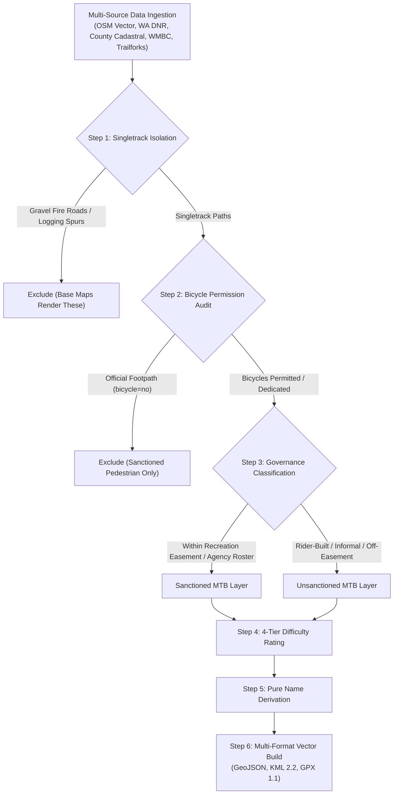

# PNW Mountain Bike Trails Geospatial Repository

A standardized, multi-source geospatial repository and auditing toolset for mountain bike trail networks across the Pacific Northwest (Western Washington).

---

## Master Mapping & Auditing Methodology

To provide authentic, rideable, and legally clear datasets, every trail in this repository is processed through a strict, multi-stage geospatial pipeline.



### 1. Authoritative Datasets & Exact API Specifications
Every network is built from real, verifiable government and community databases:

| Domain | Dataset / Service Name | Exact Identifier / API Endpoint | Purpose |
| :--- | :--- | :--- | :--- |
| **Physical Geometry** | OpenStreetMap (OSM) Core API 0.6 | `https://api.openstreetmap.org/api/0.6/map?bbox=min_lon,min_lat,max_lon,max_lat` | Sub-meter node coordinates, way geometry, surface, and width. |
| **Physical Geometry** | Overpass API QL | `https://overpass-api.de/api/interpreter` | High-volume tag filtering and historical lineage audits. |
| **Conservation Boundaries** | King County Cadastral Parcel Database | Parcel PIN `1423089001` (Rattlesnake Mountain NRCA) | Auditing RCW 79.71 state conservation boundary violations. |
| **Forest Transportation** | WA DNR Public Forest Practices Layer | Washington State Department of Natural Resources GIS Portal | Identifying authorized forestry spurs vs. unauthorized trail breaches. |
| **Recreation Easements** | City of Bellingham / Whatcom Land Trust | Whatcom County Auditor File Nos. `2018-0803004` & `2018-0807005` | 2,182-acre Galbraith Mountain Recreational Use Easement boundary. |
| **State Forest Corridors** | WA DNR Blanchard State Forest GIS | Blanchard State Forest Non-Motorized Recreation Plan | Authorized gravity corridors (*Double Black Diamond, Double Down*). |
| **County Park Master Plans** | Whatcom County Parks & Recreation GIS | Lookout Mountain Forest Preserve & Lake Whatcom Park Inventory | Legal park trail alignments and Stimpson Nature Reserve fences. |
| **Official Trail Registers** | WMBC & EMBA Trail Inventories | Whatcom Mountain Bike Coalition & Evergreen Mountain Bike Alliance | Authorized maintenance rosters and directional flow rules. |
| **Community Riding Intelligence** | Trailforks Regional Databases | Regions `431` (Galbraith), `1686` (Chuckanut), `1687` (Blanchard), `17820` (Lookout) | Real rider condition logs, community names, and secondary line tracking. |

### 2. Singletrack Isolation & Fire Road Exclusion
We are exclusively concerned with **mountain bike singletrack trails**:
* **Excluded:** All gravel logging roads, doubletracks, and service spurs (e.g., `RD 2000` series, `Tower Road`, `BL-1616`, `Pipeline Road`, `OC-17`) are stripped out. These represent basic transportation infrastructure already rendered by standard base maps (CalTopo, Gaia GPS, OSM).
* **Retained:** Natural surface dirt paths, machine-built flow trails, hand-cut singletracks, and wooden technical features.

### 3. Exclusion of Pedestrian-Only Trails
A common failure in automated scraping is including official hiking trails that prohibit bicycles:
* **The Rule:** Any trail that is an officially sanctioned park footpath where bicycles are legally prohibited (`bicycle=no`, `bicycle=dismount`) is **completely excluded**. 
* Examples excluded: *Fragrance Lake Trail*, *Rock Trail*, and *Stimpson Family Nature Reserve* loops. These are sanctioned walking paths, not mountain bike trails.

### 4. Sanctioned vs. Unsanctioned Classification
The distinction between sanctioned and unsanctioned is defined by **legal management and maintenance accountability**:
* **Sanctioned MTB Trails:** Trails situated within legally binding recreation easements (such as the 2,182-acre Galbraith Mountain Recreation Easement) or formally adopted under State/County park master plans. An insured organization (WMBC, EMBA, County/State) actively manages, inspects, and maintains them.
* **Unsanctioned MTB Trails:** Real, ridden singletracks cut and maintained by underground volunteer riders or rogue trail builders. These lack formal agency adoption, sit outside official recreation easements, cross private timber boundaries, or represent historical freeride lines that public agencies refused to sanction.

### 5. Trail Naming Derivation Methodology
To ensure vector layers remain readable on mobile GPS devices, bike computers, and mapping apps, trail names are derived strictly under these rules:
1. **Primary Source (Official Ground-Truth):** Signed trailheads, posted kiosk maps, and agency register names (e.g., *Unemployment Line*, *Evolution*, *Cougar Ridge*).
2. **Secondary Source (Community Consensus):** Widely accepted underground builder names from Trailforks and local riding lore (e.g., *Bruce Willis*, *Balls Deep*, *Fiona Ridge*, *Brown Pow*).
3. **Tertiary Source (Topological Continuity):** Unnamed link segments, alternate lines, and bypasses inherit their name from the parent trail based on topological connection (e.g., *Return Policy Bypass North*, *Cedar Dust Jumps Exit*, *Evolution Alt*).
4. **Zero Prefix Clutter:** Trail names never include status prefixes like `[UNSANCTIONED]` or `[DECOM]`. Name strings remain 100% clean; regulatory status and difficulty are communicated entirely through file separation and vector color styling.

### 6. Trail Difficulty Rating Methodology (4-Tier IMBA / Trailforks TDRS)
Difficulty ratings are assigned using a deterministic 4-tier hierarchy:
* **Tier 1 (Explicit Metadata):** Direct parsing of `mtb:scale:imba` (levels 1–5), `mtb:scale`, or `difficulty` tags.
* **Tier 2 (Community Ground-Truth Lookups):** For established named trails missing an OSM tag (e.g., *911*, *Devilcross*, *Cinco*, *Fiona Ridge*), ratings are looked up directly from WMBC/Trailforks registers.
* **Tier 3 (Geospatial Physical Metrics):** For unlisted or rogue lines, difficulty is calculated from 3D geometry and USGS Digital Elevation Models (DEM):
  $$\text{Grade} = \frac{\Delta \text{Elevation}}{\text{Distance}} \times 100$$
  * Grade < 8% $\rightarrow$ **Green Circle** (`#22c55e`)
  * Grade 8%–18% $\rightarrow$ **Blue Square** (`#0284c7`)
  * Grade 18%–30% $\rightarrow$ **Black Diamond** (`#dc2626`)
  * Sustained Grade > 30% or high drop density $\rightarrow$ **Double Black Diamond** (`#000000`)
* **Tier 4 (Unsanctioned Freeride Default):** Unsanctioned gravity trails in the PNW default to **Black Diamond (`#dc2626`)** unless physical metrics or pro-line jump features elevate them to **Double Black / Pro-Line**.

### 7. Vector Styling & Format Specifications

| Format | Extension | Target Platforms | Specifications |
| :--- | :--- | :--- | :--- |
| **GeoJSON** | `.geojson` | Web GIS, QGIS, ArcGIS | WGS84 CRS, LineString geometries with full tag metadata, difficulty ratings, and length attributes. |
| **KML 2.2** | `.kml` | CalTopo, Gaia GPS, Google Earth | Pure static vector line `<Placemark>` features with pre-baked hex color styles (no animated GPS playback routes). |
| **GPX 1.1** | `.gpx` | Garmin Edge, Wahoo, GPS Units | Vector tracks (`<trk>`) enriched with `<tf:...>` Trailforks and `<gpxx:...>` Garmin color extensions. |

#### Color Palette Legend
* **Green Circle (Beginner):** `#22c55e`
* **Blue Square (Intermediate):** `#0284c7`
* **Black Diamond (Advanced):** `#dc2626`
* **Double Black Diamond (Expert):** `#000000`
* **Pro-Line (Extreme Jump Lines):** `#8b5cf6` (or `#eab308`)
* **Decommissioning Target / Regulatory Warning:** `#ea580c` (Blaze Orange)
* **Physically Demolished / Rehabilitated:** `#475569` (Ghost Slate)

---

## Repository Directory & Script Structure

Every subfolder includes a dedicated `scripts/` directory containing the standalone, reproducible Python build script used to generate that exact dataset:

```text
pnw-mtb-trails/
├── README.md                           # Master methodology, rating standards & architecture
│
├── i-90-corridor/
│   ├── README.md                       # Regional I-90 corridor guide & agency boundaries
│   └── exit-27/                        # Exit 27 / Rattlesnake Mountain unsanctioned network
│       ├── README.md                   # Trail roster, King County PIN audit & status breakdown
│       ├── scripts/
│       │   └── build_exit27.py         # Standalone build script for Exit 27 vector datasets
│       ├── exit27_unsanctioned_trails.kml
│       ├── exit27_unsanctioned_network.geojson
│       ├── exit27_unsanctioned_network.gpx
│       ├── exit27_active_freeride.gpx
│       ├── exit27_WILL_BE_decommissioned.gpx
│       └── exit27_ALREADY_decommissioned.gpx
│
└── bellingham/
    ├── README.md                       # Whatcom County regional overview & easement guide
    ├── galbraith-mountain/
    │   ├── README.md                   # 2,182-acre easement history, roster & jump complexes
    │   ├── scripts/
    │   │   └── build_galbraith.py      # Standalone build script for Galbraith Mountain
    │   ├── galbraith_sanctioned.geojson / .kml / .gpx
    │   └── galbraith_unsanctioned.geojson / .kml / .gpx
    ├── chuckanut-blanchard/
    │   ├── README.md                   # Larrabee State Park & Blanchard Forest gravity lines
    │   ├── scripts/
    │   │   └── build_chuckanut.py      # Standalone build script for Chuckanut & Blanchard
    │   ├── chuckanut_sanctioned.geojson / .kml / .gpx
    │   └── chuckanut_unsanctioned.geojson / .kml / .gpx
    └── lookout-mountain/
        ├── README.md                   # Lake Whatcom, Sudden Valley & Stewart Mountain lines
        ├── scripts/
        │   └── build_lookout.py        # Standalone build script for Lookout & Stewart Mountain
        ├── lookout_sanctioned.geojson / .kml / .gpx
        └── lookout_unsanctioned.geojson / .kml / .gpx
```
