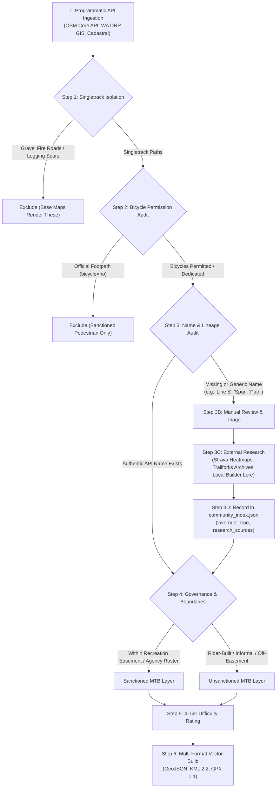

# PNW Mountain Bike Trails Geospatial Repository

A standardized, multi-source geospatial repository and auditing toolset for mountain bike trail networks across the Pacific Northwest (Western Washington).

---

## Master Mapping & Auditing Methodology

To provide authentic, rideable, and legally clear datasets, every trail in this repository is processed through a strict, multi-stage geospatial pipeline that balances **automated programmatic ingestion** with **human-in-the-loop manual review and external research**.



---

### 1. The Core Data Challenge: Why APIs Alone Are Inadequate for Unsanctioned Trails
In public mapping databases (OpenStreetMap, USGS, state GIS layers):
* **Sanctioned trails** have publicly maintained metadata, signage, and tags. Programmatic API ingestion handles them cleanly.
* **Unsanctioned / pirate trails** intentionally have omitted, obfuscated, or generic names in public APIs (e.g., tagged simply as `path`, `Line 5`, or left blank) to protect physical lines from land managers and ranger enforcement.
* **Our Policy:** Blindly trusting the API produces dozens of useless `Freeride Singletrack (12345)` labels on a rider's GPS unit. Conversely, hardcoding names directly into Python scripts creates brittle, unmaintainable code.

---

### 2. The Solution: Programmatic First, Override as Last Resort

We resolve this through a strict 4-step pipeline:

#### Step 1: Programmatic First Pass (Automated API Ingestion)
The build scripts query the real APIs (OpenStreetMap Core API, WA DNR transportation layer, King County Cadastral) to extract live node coordinates, geometry, and raw tags. If a valid, authentic community name already exists in the API (`name`, `official_name`, `loc_name`), it is accepted automatically.

#### Step 2: Manual Review & High-Judgment Triage
Extracted trail names are audited:
* Authentic names (*Unemployment Line, Mohawk, Blue Steel, Evolution*) roll straight through.
* Missing names or names that appear generic/suspect upon inspection (e.g., `'path'`, `'line 5'`, `'spur'`, surveyor tags, or numeric placeholders) are flagged for human review.

#### Step 3: External Ground-Truth Research
For flagged lines, research is conducted outside public APIs using real-world rider sources:
* **Strava Heatmaps & Segment Leaderboards:** Identifying what local riders actually title the descent.
* **Trailforks Historical & Secondary Directories:** Checking rider condition logs, hidden submissions, and regional forums.
* **Local Builder Lore & Video Archives:** Matching physical line features (rock drops, road gaps, timber benches) to known community trail names.

#### Step 4: The Community Index (`community_index.json`)
The manual research is codified into a transparent, version-controlled JSON data file in each subfolder:
```json
{
  "1285750011": {
    "override": true,
    "override_reason": "API had no name tag; line is verified as historic B-Line DH track",
    "name": "B-Line",
    "difficulty": "Double Black Diamond",
    "status": "Active Freeride",
    "research_sources": [
      "Local builder consensus (Exit 27 crew)",
      "Strava Segment: B-Line DH",
      "Historical Trailforks ride log"
    ]
  }
}
```
* **Explicit Override Flag (`"override": true`):** The build scripts check this flag. If `true`, the generic API name is replaced by the researched community name.
* **Strict Quality Fallback:** If an unsanctioned line has no name in the API, has no topological connection to a known trail, and has not been vetted in `community_index.json`, it is **excluded from export** rather than polluting maps with generic IDs.

---

### 3. Authoritative Datasets & Exact API Specifications

| Domain | Dataset / Service Name | Exact Identifier / API Endpoint | Purpose |
| :--- | :--- | :--- | :--- |
| **Physical Geometry** | OpenStreetMap (OSM) Core API 0.6 | `https://api.openstreetmap.org/api/0.6/map?bbox=min_lon,min_lat,max_lon,max_lat` | Sub-meter node coordinates, way geometry, surface, and width. |
| **Conservation Boundaries** | King County Cadastral Parcel Database | Parcel PIN `1423089001` (Rattlesnake Mountain NRCA) | Auditing RCW 79.71 state conservation boundary violations. |
| **Forest Transportation** | WA DNR Public Forest Practices Layer | Washington State Department of Natural Resources GIS Portal | Identifying authorized forestry spurs vs. unauthorized trail breaches. |
| **Recreation Easements** | City of Bellingham / Whatcom Land Trust | Whatcom County Auditor File Nos. `2018-0803004` & `2018-0807005` | 2,182-acre Galbraith Mountain Recreational Use Easement boundary. |
| **State Forest Corridors** | WA DNR Blanchard State Forest GIS | Blanchard State Forest Non-Motorized Recreation Plan | Authorized gravity corridors (*Double Black Diamond, Double Down*). |
| **County Park Master Plans** | Whatcom County Parks & Recreation GIS | Lookout Mountain Forest Preserve & Lake Whatcom Park Inventory | Legal park trail alignments and Stimpson Nature Reserve fences. |
| **Community Ground Truth** | Local Research Index | `community_index.json` in each network directory | Vetted manual research, naming provenance, and override layer. |

---

### 4. Singletrack Isolation & Footpath Exclusion
* **Gravel Roads Excluded:** All logging doubletracks and service spurs (`RD 2000` series, `Tower Road`, `BL-1616`, `Pipeline Road`, `OC-17`) are stripped out.
* **Pedestrian Footpaths Excluded:** Any sanctioned walking trail where bicycles are legally prohibited (`bicycle in ['no', 'dismount']` on non-informal paths like *Fragrance Lake, Rock Trail, Stimpson Reserve*) is completely excluded.

---

### 5. Trail Difficulty Rating Methodology (4-Tier IMBA / Trailforks TDRS)
Difficulty ratings are assigned using a deterministic 4-tier hierarchy:
* **Tier 1 (Explicit Metadata):** Direct parsing of `mtb:scale:imba` (levels 1–5), `mtb:scale`, or `difficulty` tags.
* **Tier 2 (Index Overrides):** Overrides provided in `community_index.json` based on rider consensus and physical features.
* **Tier 3 (Geospatial Physical Metrics):** For unlisted lines, difficulty is calculated from 3D geometry and USGS Digital Elevation Models (DEM):
  $$\text{Grade} = \frac{\Delta \text{Elevation}}{\text{Distance}} \times 100$$
  * Grade < 8% $\rightarrow$ **Green Circle** (`#22c55e`)
  * Grade 8%–18% $\rightarrow$ **Blue Square** (`#0284c7`)
  * Grade 18%–30% $\rightarrow$ **Black Diamond** (`#dc2626`)
  * Sustained Grade > 30% or high drop density $\rightarrow$ **Double Black Diamond** (`#000000`)
* **Tier 4 (Unsanctioned Freeride Default):** Unsanctioned gravity trails in the PNW default to **Black Diamond (`#dc2626`)** unless physical metrics or pro-line jump features elevate them to **Double Black / Pro-Line**.

---

### 6. Vector Styling & Format Specifications

| Format | Extension | Target Platforms | Specifications |
| :--- | :--- | :--- | :--- |
| **GeoJSON** | `.geojson` | Web GIS, QGIS, ArcGIS | WGS84 CRS, LineString geometries with full tag metadata, difficulty ratings, and length attributes. |
| **KML 2.2** | `.kml` | CalTopo, Gaia GPS, Google Earth | Pure static vector line `<Placemark>` features with pre-baked hex color styles (no animated GPS playback routes). |
| **GPX 1.1** | `.gpx` | Garmin Edge, Wahoo, GPS Units | Vector tracks (`<trk>`) enriched with `<tf:...>` Trailforks and `<gpxx:...>` Garmin color extensions. |

#### Color Palette Legend
* **Green Circle (Beginner):** `#22c55e`
* **Blue Square (Intermediate):** `#0284c7`
* **Black Diamond (Advanced):** `#dc2626`
* **Double Black Diamond (Expert):** `#000000`
* **Pro-Line (Extreme Jump Lines):** `#8b5cf6`
* **Decommissioning Target / Warning:** `#ea580c` (Blaze Orange)
* **Physically Demolished / Closed:** `#475569` (Ghost Slate)

---

## Repository Directory & Script Structure

```text
pnw-mtb-trails/
├── README.md                           # Master methodology, rating standards & architecture
│
├── i-90-corridor/
│   ├── README.md                       # Regional I-90 corridor guide & agency boundaries
│   └── exit-27/                        # Exit 27 / Rattlesnake Mountain unsanctioned network
│       ├── README.md                   # Trail roster, King County PIN audit & provenance table
│       ├── scripts/
│       │   ├── build_exit27.py         # Dynamic build script (queries API + applies index)
│       │   └── community_index.json    # Research index with override: true entries
│       ├── exit27_unsanctioned_trails.kml
│       ├── exit27_unsanctioned_network.geojson
│       ├── exit27_unsanctioned_network.gpx
│       ├── exit27_active_freeride.gpx
│       ├── exit27_WILL_BE_decommissioned.gpx
│       └── exit27_ALREADY_decommissioned.gpx
│
└── bellingham/
    ├── README.md                       # Whatcom County regional overview & easement guide
    ├── galbraith-mountain/
    │   ├── README.md                   # 2,182-acre easement history, roster & jump complexes
    │   ├── scripts/
    │   │   ├── build_galbraith.py      # Dynamic build script for Galbraith
    │   │   └── community_index.json    # Research index for off-easement / decommissioned lines
    │   ├── galbraith_sanctioned.geojson / .kml / .gpx
    │   └── galbraith_unsanctioned.geojson / .kml / .gpx
    ├── chuckanut-blanchard/
    │   ├── README.md                   # Larrabee State Park & Blanchard Forest gravity lines
    │   ├── scripts/
    │   │   ├── build_chuckanut.py      # Dynamic build script for Chuckanut & Blanchard
    │   │   └── community_index.json    # Research index for pirate ridge lines & drops
    │   ├── chuckanut_sanctioned.geojson / .kml / .gpx
    │   └── chuckanut_unsanctioned.geojson / .kml / .gpx
    └── lookout-mountain/
        ├── README.md                   # Lake Whatcom, Sudden Valley & Stewart Mountain lines
        ├── scripts/
        │   ├── build_lookout.py        # Dynamic build script for Lookout & Stewart Mountain
        │   └── community_index.json    # Research index for user-maintained timber lines (#5, #8)
        ├── lookout_sanctioned.geojson / .kml / .gpx
        └── lookout_unsanctioned.geojson / .kml / .gpx
```
